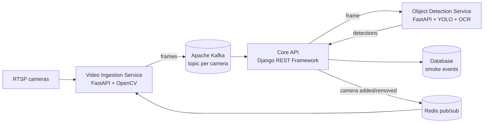

# EnviroTrack

**Real-time detection of smoke-emitting vehicles from traffic cameras.**

EnviroTrack watches live camera feeds, detects vehicles that are emitting visible smoke, reads their number plates, and records each violation with an image, confidence score and smoke intensity, so the authorities can review it and take action.

Final Year Project, BS Computer Science, FAST-NU Lahore (2026).

**Live API docs:** https://envirotrack-core.onrender.com/docs/
*(Hosted on Render's free tier. The first request may take up to a minute while the service wakes up.)*

---

## Architecture

EnviroTrack is built as three Python services connected by Apache Kafka and Redis.



| Service | Path | Responsibility |
|---|---|---|
| **Core API** | `backend/core` | Users, roles and auth; camera management; Kafka frame consumer; smoke-event storage; REST API with OpenAPI docs |
| **Object Detection Service** | `backend/object-detection-service` | Vehicle detection, smoke detection, number-plate detection and OCR behind an API-key-protected endpoint |
| **Video Ingestion Service** | `backend/video-ingestion-service` | Pulls RTSP streams as async workers with auto-reconnect and publishes frames to Kafka |
| **Kafka / Redis** | `backend/kafka`, `backend/redis` | Message broker (KRaft mode) and pub/sub, run with Docker Compose |

### Detection pipeline

1. **Vehicle detection:** YOLOv8m finds vehicles in the frame
2. **Smoke detection:** a custom-trained YOLO model checks for visible smoke
3. **Number-plate detection:** YOLOv8m locates the plate on the flagged vehicle, and the plate is cropped
4. **OCR:** EasyOCR reads the plate text, then the text is cleaned up in post-processing
5. **Event:** the Core API saves the frame, confidence and smoke intensity as a smoke event

---

## Model results

### Smoke detection: three YOLO architectures compared

| Model | mAP50 | mAP50-95 | Precision | Recall |
|---|---|---|---|---|
| YOLOv8L | 0.808 | 0.350 | 0.790 | 0.808 |
| YOLOv11L | 0.829 | 0.358 | 0.850 | 0.833 |
| **YOLOv26L (selected)** | **0.868** | **0.388** | **0.871** | **0.834** |

### Number-plate detection (ANPR)

| Model | mAP50 | mAP50-95 | Precision | Recall |
|---|---|---|---|---|
| YOLOv8m | 0.97 | 0.70 | 0.94 | 0.90 |

---

## Core API features

- JWT authentication (login, refresh) with role-based admin permissions
- Invite users by email, set password, forgot/reset password, change password
- Camera CRUD; every change is published to Redis so streams start and stop without a restart
- Versioned endpoints (`/api/v1/...`) with Swagger UI at `/docs/` and ReDoc at `/redoc/`
- Health check at `/health/`

---

## Tech stack

**Backend:** Python, Django, Django REST Framework, SimpleJWT, drf-spectacular, FastAPI, Uvicorn
**Machine learning:** Ultralytics YOLO (v8 / v11 / v26), PyTorch, EasyOCR, Roboflow, OpenCV
**Infrastructure:** Apache Kafka, Redis, Docker, Docker Compose, Render
**Tooling:** Ruff, Makefile / shell task runners

---

## Getting started

### Prerequisites
- Python 3.10+
- Docker and Docker Compose
- A Roboflow API key (for the number-plate model)

### 1. Start Kafka and Redis

```bash
cd backend/kafka && KAFKA_PORT=9092 docker compose up -d
cd ../redis && REDIS_PORT=6379 docker compose up -d
```

### 2. Object Detection Service (port 8001)

```bash
cd backend/object-detection-service
./doit.sh setup
cp .env.example .env   # or create .env with the variables below
./doit.sh run
```

| Variable | Description |
|---|---|
| `API_KEY` | Shared key the Core API sends in the `X-API-Key` header |
| `ROBOFLOW_API_KEY` | Roboflow key for the plate-detection model |

Model weights are expected in `models/` (`smoke_model.pt`, `yolov8m.pt`).

### 3. Core API (port 8000)

```bash
cd backend/core
python -m venv .venv && source .venv/bin/activate
pip install -r requirements.txt
cp ../.env.example .env   # then set the values below
python manage.py migrate
python manage.py createsuperuser
python manage.py runserver 8000
```

Start the frame consumer in a second terminal:

```bash
python manage.py capturestream
```

| Variable | Description |
|---|---|
| `DJANGO_SECRET_KEY` | Django secret key (required) |
| `DJANGO_DEBUG` | `True` for local development |
| `ALLOWED_HOSTS` | Comma-separated hostnames |
| `AI_SERVICE_URL` | Object Detection Service URL, e.g. `http://localhost:8001` |
| `AI_SERVICE_API_KEY` | Same value as the detection service's `API_KEY` |
| `REDIS_HOST`, `REDIS_PORT` | Redis connection |
| `KAFKA_HOST`, `KAFKA_PORT`, `KAFKA_TOPIC` | Kafka connection and topic to consume |

Generate a secret key:

```bash
python -c "from django.core.management.utils import get_random_secret_key; print(get_random_secret_key())"
```

### 4. Video Ingestion Service (port 8002)

```bash
cd backend/video-ingestion-service
./doit.sh setup
./doit.sh run          # stream API
./doit.sh run-video    # or: send the sample video.mp4 to Kafka
```

| Variable | Description |
|---|---|
| `KAFKA_HOST`, `KAFKA_PORT` | Kafka connection |
| `KAFKA_TOPIC_PREFIX` | Topic prefix; each camera gets `<prefix>.<camera_id>` |

---

## Project structure

```
backend/
├── core/                       # Django REST API
│   ├── users/                  # auth, roles, invites, password flows
│   ├── cameras/                # camera CRUD + Redis publisher
│   ├── framestream/            # Kafka consumer -> detection service
│   ├── events/                 # smoke-event model and storage
│   └── shared/                 # common models and utilities
├── object-detection-service/   # FastAPI + YOLO + OCR inference
├── video-ingestion-service/    # FastAPI + OpenCV stream workers -> Kafka
├── kafka/                      # Kafka (KRaft) docker-compose
└── redis/                      # Redis docker-compose
```

---

## Team

| Name | Contribution |
|---|---|
| [Muhammad Sharjeel Ali](https://www.linkedin.com/in/sharjeel-ali07) | Model training and evaluation (smoke, vehicle, ANPR), Core API (Django REST Framework) |
| [Noor ul Ain] | [contribution] |
| [Eemaan Ahmed] | [contribution] |

**Supervisor:** [Abeeda Akram]
